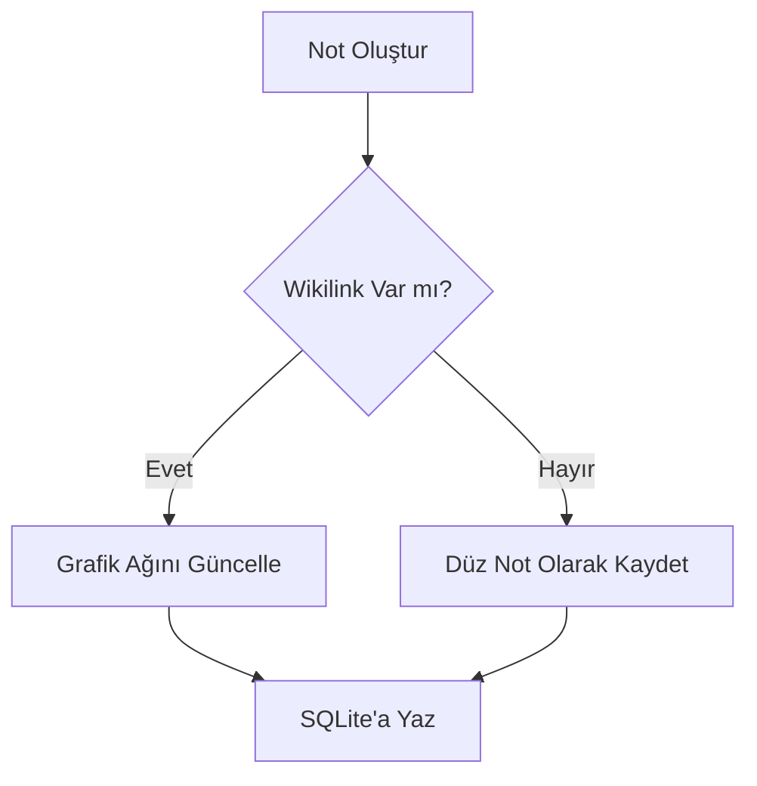

# Not Defterim — Yeni Nesil Özellikler Teknik Araştırma ve Uygulama Şartnamesi
**Rol:** `tech-scout`  
**Tarih:** Kasım 2026  
**Platformlar:** Masaüstü (Rust / Tao / Wry / Vanilla JS) & Mobil (Android / Jetpack Compose / Kotlin)  
**Hedef:** Not Defterim uygulamasını küresel standartlarda bir Kişisel Bilgi Yönetimi (PKM - Personal Knowledge Management) ve ikinci beyin (Second Brain) platformuna dönüştürmek.

---

## İÇİNDEKİLER
1. [Giriş ve Mimari Vizyon](#1-giriş-ve-mimari-vizyon)
2. [Özellik 1: İnteraktif Not İlişki Grafiği (Knowledge Graph / Graph View)](#2-özellik-1-i̇nteraktif-not-i̇lişki-grafiği-knowledge-graph--graph-view)
3. [Özellik 2: Hızlı Komut Paleti (Command Palette - Ctrl+K)](#3-özellik-2-hızlı-komut-paleti-command-palette---ctrlk)
4. [Özellik 3: Masaüstü Yapışkan Not Modu (Sticky Notes Widget)](#4-özellik-3-masaüstü-yapışkan-not-modu-sticky-notes-widget)
5. [Özellik 4: Markdown Eklentileri (KaTeX Matematik & Mermaid Şemaları)](#5-özellik-4-markdown-eklentileri-katex-matematik--mermaid-şemaları)
6. [Özellik 5: Gelişmiş Dışa Aktarma & Yazdırma (CSS Print / PDF Rapor)](#6-özellik-5-gelişmiş-dışa-aktarma--yazdırma-css-print--pdf-rapor)
7. [Özellik 6: Android Mobil Uyarlamaları (Jetpack Compose & Glance)](#7-özellik-6-android-mobil-uyarlamaları-jetpack-compose--glance)
8. [Uygulama ve Entegrasyon Yol Haritası](#8-uygulama-ve-entegrasyon-yol-haritası)

---

## 1. Giriş ve Mimari Vizyon

Not Defterim, hafifliği, yerel veri gizliliği (SQLite + XChaCha20-Poly1305 şifreleme) ve sıfır dış bağımlılık odaklı yüksek performansı ile öne çıkmaktadır. Yeni eklenecek özelliklerin tasarımında aşağıdaki temel ilkeler korunacaktır:

1. **Sıfır Şişkinlik (Zero-Bloat) İlkesi:** 20 MB'lık ağır npm kütüphaneleri (D3.js dev paketleri, ağır frameworkler) yerine; hafif, modüler ve yerel web API'lerini (HTML5 Canvas, CSS Grid/Print, Web Workers) kullanan cerrahi çözümler uygulanacaktır.
2. **Platformlar Arası Veri Uyumu:** Wikilinkler (`[[not_adi]]`), etiketler (`#etiket`) ve formüller hem masaüstü (Wry) hem de mobil (Compose) tarafında birebir aynı sözdizimi ile tanınacaktır.
3. **Çevrimdışı ve Yerel Öncelikli (Offline-First):** Tüm render motorları (KaTeX, Mermaid, Graph) internet bağlantısı gerektirmeksizin yerel assetler üzerinden çalışacaktır.

---

## 2. Özellik 1: İnteraktif Not İlişki Grafiği (Knowledge Graph / Graph View)

### 2.1. Amaç ve Konsept
Not Defterim içerisinde halihazırda bulunan `[[Not Başlığı]]` veya `[[Not Başlığı|Görünen İsim]]` çift yönlü wikilink bağlantılarını Obsidian, Roam Research veya Logseq tarzı interaktif bir 2D kuvvet simülasyon grafiğine (Force-Directed Graph) dönüştürmek. Kullanıcı, notları arasındaki kavramsal bağlantıları görebilecek, kümelenmeleri keşfedebilecek ve düğümlere tıklayarak notlar arasında gezinebilecektir.

### 2.2. Veri Çıkarımı ve Ağ Topolojisi
Grafiğin oluşturulabilmesi için notların taranarak düğüm (Node) ve kenar (Edge) listesinin çıkarılması gerekir:

```javascript
// Graph Data Modeli
interface GraphNode {
  id: string;          // Not UUID / ID
  title: string;       // Not Başlığı
  category: string;    // Kategori adı veya ID (renk kodlaması için)
  linkCount: number;   // Düğüme bağlı link sayısı (düğüm yarıçapını belirler)
  x: number;           // 2D Canvas X pozisyonu
  y: number;           // 2D Canvas Y pozisyonu
  vx: number;          // X ekseni hızı
  vy: number;          // Y ekseni hızı
}

interface GraphLink {
  source: string;      // Kaynak Not ID
  target: string;      // Hedef Not ID
}
```

#### Notlardan Wikilink Çıkarma Fonksiyonu:
```javascript
function extractGraphTopology(notes) {
  const titleMap = new Map();
  notes.forEach(note => {
    titleMap.set(note.title.trim().toLowerCase(), note.id);
  });

  const nodes = [];
  const links = [];
  const linkCountMap = new Map();

  const wikilinkRegex = /\[\[([^\]\|]+)(?:\|([^\]]+))?\]\]/g;

  notes.forEach(note => {
    nodes.push({
      id: note.id,
      title: note.title,
      category: note.category_id || 'default',
      x: (Math.random() - 0.5) * 600,
      y: (Math.random() - 0.5) * 600,
      vx: 0,
      vy: 0
    });

    let match;
    const content = note.content || '';
    while ((match = wikilinkRegex.exec(content)) !== null) {
      const targetTitle = match[1].trim().toLowerCase();
      if (titleMap.has(targetTitle)) {
        const targetId = titleMap.get(targetTitle);
        if (targetId !== note.id) {
          links.push({ source: note.id, target: targetId });
          linkCountMap.set(note.id, (linkCountMap.get(note.id) || 0) + 1);
          linkCountMap.set(targetId, (linkCountMap.get(targetId) || 0) + 1);
        }
      }
    }
  });

  nodes.forEach(node => {
    node.linkCount = linkCountMap.get(node.id) || 0;
    node.radius = Math.max(5, Math.min(18, 5 + node.linkCount * 2));
  });

  return { nodes, links };
}
```

### 2.3. Hafif Canvas Force-Directed Simülasyon Motoru (Zero-Dependency)
Harici ağır kütüphane eklemek yerine saf JavaScript ve HTML5 Canvas ile 60 FPS çalışan Verlet/Euler tabanlı simülasyon:

1. **İtme Kuvveti (Coulomb Repulsion):** Tüm düğümler birbirini iterek üst üste binmeyi önler:  
   $F_r = \frac{k_r}{d^2}$
2. **Çekme / Yay Kuvveti (Hooke's Spring):** Wikilink ile bağlı düğümler birbirini çeker:  
   $F_s = k_s \times (d - L_0)$
3. **Merkezleme Kuvveti (Centering Gravity):** Notların ekrandan kaybolmasını önleyip merkeze doğru hafifçe çeker:  
   $F_c = -k_c \times pos$
4. **Sönümleme (Damping / Friction):** Titreşimi durdurmak için hız her adımda \%90'a düşürülür:  
   $v = v \times 0.90$

### 2.4. Kullanıcı Etkileşimleri (UX)
- **Zoom & Pan:** Fare tekerleği ile yakınlaşma (`ctx.scale`), sürükleyerek tuvali kaydırma (`ctx.translate`).
- **Düğüm Sürükleme (Drag):** Fare ile bir nota tıklandığında sürüklenip serbest bırakılabilir.
- **Hover Vurgulama (Focus Mode):** Bir düğmenin üzerine gelindiğinde sadece bağlantılı olduğu notlar ve çizgiler parlar, diğer düğümler `%20` opaklığa düşürülür.
- **Tıklama ile Not Açma:** Düğüme tıklandığında grafik modalı kapanır ve seçilen not ana editörde açılır.
- **Filtreler:**
  - İzole notları (bağlantısı olmayanları) gizle/göster.
  - Kategoriye göre renk paleti (İş: Mavi, Kişisel: Yeşil, Proje: Mor).

---

## 3. Özellik 2: Hızlı Komut Paleti (Command Palette - Ctrl+K)

### 3.1. Amaç ve Konsept
VSCode, Obsidian ve Raycast'te standart haline gelen klavye odaklı hızlı erişim modalı. Kullanıcı fareye dokunmadan tek bir kısayolla (`Ctrl+K` veya `Ctrl+P`) not arayabilir, temayı değiştirebilir, yedekleme alabilir veya yeni not oluşturabilir.

### 3.2. Modal Mimarisi ve Prefix Tabanlı Arama
Kullanıcı girişine göre akıllı mod geçişi:

| Giriş Örneği | Mod | Açıklama |
|---|---|---|
| `toplantı` | **Fuzzy Not Arama** | Not başlıklarında ve içeriklerinde anlık arama |
| `> tema` | **Komut Yürütme** | Sistem komutlarını listeler ve çalıştırır |
| `#yazılım` | **Etiket Filtresi** | Belirli bir etikete sahip notları listeler |
| `@projeler` | **Kategori Filtresi**| Seçilen kategorideki notları listeler |
| `?` | **Yardım Modu** | Kısayolları ve komutları açıklar |

### 3.3. Komut Kataloğu Örneği
```javascript
const COMMANDS = [
  { id: "new_note", label: "Yeni Not Oluştur", shortcut: "Ctrl+N", icon: "➕", action: () => createNewNote() },
  { id: "open_graph", label: "İlişki Grafiğini Aç (Knowledge Graph)", shortcut: "Ctrl+G", icon: "🕸️", action: () => openGraphView() },
  { id: "toggle_sticky", label: "Yapışkan Not Moduna Geç", shortcut: "Ctrl+Shift+S", icon: "📌", action: () => openStickyMode() },
  { id: "export_pdf", label: "Aktif Notu PDF Olarak Dışa Aktar", shortcut: "Ctrl+P", icon: "📄", action: () => exportActiveNoteToPdf() },
  { id: "theme_dark", label: "Karanlık Temaya Geç", shortcut: "", icon: "🌙", action: () => setTheme("dark") },
  { id: "theme_light", label: "Aydınlık Temaya Geç", shortcut: "", icon: "☀️", action: () => setTheme("light") },
  { id: "sync_now", label: "Mobil ile Şimdi Senkronize Et", shortcut: "F5", icon: "🔄", action: () => triggerSync() },
  { id: "empty_trash", label: "Çöp Kutusunu Temizle", shortcut: "", icon: "🗑️", action: () => emptyTrash() },
];
```

### 3.4. Yüksek Hızlı Fuzzy Matching Algoritması
Harici kütüphane olmadan kelime başlarına ve ardışık eşleşmelere öncelik veren hafif skorlama algoritması:
```javascript
function fuzzyScore(pattern, text) {
  pattern = pattern.toLowerCase();
  text = text.toLowerCase();
  let patternIdx = 0;
  let score = 0;
  let consecutiveMatches = 0;

  for (let i = 0; i < text.length && patternIdx < pattern.length; i++) {
    if (text[i] === pattern[patternIdx]) {
      patternIdx++;
      consecutiveMatches++;
      score += 5 + (consecutiveMatches * 3); // Ardışık harfe bonus
      if (i === 0 || text[i - 1] === ' ' || text[i - 1] === '-') {
        score += 10; // Kelime başına bonus
      }
    } else {
      consecutiveMatches = 0;
    }
  }
  return patternIdx === pattern.length ? score : -1;
}
```

### 3.5. Klavye Navigasyonu
- `Ctrl + K` veya `Ctrl + P`: Modalı açar/kapatır.
- `ArrowDown` / `ArrowUp`: Sonuçlar arasında gezinir (seçili öğeye `.selected` stili verilir).
- `Enter`: Seçili notu açar veya komutu çalıştırır.
- `Escape`: Modalı kapatır ve odağı editöre geri verir.

---

## 4. Özellik 3: Masaüstü Yapışkan Not Modu (Sticky Notes Widget)

### 4.1. Amaç ve Konsept
Windows Sticky Notes (Yapışkan Notlar) konseptini yerel Rust + Wry gücüyle entegre etmek. Kullanıcı masasında çalışırken önemli bir notu kenarlıksız, her zaman üstte (pinned / always-on-top) kalacak şekilde ekranın köşesine sabitleyebilir.

### 4.2. Rust (Tao + Wry) Çoklu Pencere (Multi-Window) Mimarisi
Masaüstü uygulamamızda `desktop-native/src/main.rs` içine `open_sticky_window` IPC komutu eklenir:

```rust
// Rust Tao Pencere Tanımı
use tao::window::WindowBuilder;
use tao::dpi::LogicalSize;

pub fn create_sticky_window(event_loop: &EventLoopWindowTarget<()>, note_id: String) {
    let window = WindowBuilder::new()
        .with_title("Not Defterim - Yapışkan Not")
        .with_decorations(false)          // Kenarlıksız (Frameless)
        .with_always_on_top(true)         // Ekrana iğneli (Always on top)
        .with_resizable(true)
        .with_inner_size(LogicalSize::new(280.0, 320.0))
        .build(event_loop)
        .expect("Sticky window failed");

    // Wry webview sticky.html dosyasını yükler ve note_id'yi iletir
}
```

### 4.3. UI ve UX Tasarımı
- **Minimal Sürükleme Başlığı (Custom Drag Bar):** Kenarlıksız pencere olduğu için üstte 24px yüksekliğinde ince bir sürükleme alanı bulunur (`-webkit-app-region: drag` veya JS mousedown).
- **Her Zaman Üstte İğnesi (Pin Toggle):** İğne ikonuna basıldığında `window.ipc.postMessage({ action: "toggle_pin" })` ile her zaman üstte kalma özelliği açılıp kapatılabilir.
- **Pastel Renk Paleti:**
  - Klasik Post-it Sarısı (`#FEF08A` / `#CA8A04`)
  - Nane Yeşili (`#BBF7D0` / `#16A34A`)
  - Pudra Pembe (`#FBCFE8` / `#DB2777`)
  - Bebek Mavisi (`#BAE6FD` / `#0284C7`)
  - Pastel Lavanta (`#E9D5FF` / `#9333EA`)
- **Anlık Debounced Otomatik Kaydetme:** Yazılan her karakter 300ms sonra SQLite veritabanına kaydedilir, veri kaybı riski sıfırdır.
- **Kompakt Düzen:** Not listesi ve sol menü tamamen gizlidir; sadece başlık, içerik ve hızlı kontrol butonları yer alır.

---

## 5. Özellik 4: Markdown Eklentileri (KaTeX Matematik & Mermaid Şemaları)

### 5.1. KaTeX Matematik Formülleri Desteği
Mühendislik, matematik ve bilimsel notlar için formüllerin kusursuz render edilmesi:

#### Sözdizimi:
- **Satır İçi (Inline Math):** `$E = mc^2$` veya `$\lambda = \frac{h}{p}$`
- **Blok Formül (Display Math):**
```markdown
$$
\int_{-\infty}^{\infty} e^{-x^2} dx = \sqrt{\pi}
$$
```

#### Entegrasyon ve Güvenlik:
- `desktop-native/ui/vendor/katex/katex.min.js` ve `katex.min.css` yerel dosya olarak projeye eklenir. Hiçbir harici CDN çağrısı yapılmaz.
- Parse Aşaması:
```javascript
function renderMathExpressions(html) {
  // 1. Blok formüller ($$...$$)
  html = html.replace(/\$\$([\s\S]*?)\$\$/g, (match, formula) => {
    try {
      return katex.renderToString(formula.trim(), { displayMode: true, throwOnError: false });
    } catch (e) {
      return `<pre class="math-error">${escapeHtml(formula)}</pre>`;
    }
  });

  // 2. Satır içi formüller ($...$)
  html = html.replace(/\$([^\$\n]+?)\$/g, (match, formula) => {
    try {
      return katex.renderToString(formula.trim(), { displayMode: false, throwOnError: false });
    } catch (e) {
      return `<code class="math-error">${escapeHtml(formula)}</code>`;
    }
  });

  return html;
}
```

### 5.2. Mermaid.js Şemaları ve Akış Diyagramları
Yazılımcılar ve mimarlar için metin tabanlı diyagram desteği:

#### Desteklenen Şema Tipleri:
- Akış Şemaları (`flowchart TD`, `graph LR`)
- Sıralama Diyagramları (`sequenceDiagram`)
- Durum Makineleri (`stateDiagram-v2`)
- Sınıf Diyagramları (`classDiagram`)
- Zaman Çizelgeleri (`gantt`)

#### Örnek Markdown Bloğu:
````markdown

````

#### Performans ve Bellek Yönetimi (Lazy Render):
Mermaid kütüphanesi ağır olabileceğinden (~700 KB), sadece önizleme metninde ````mermaid` sözdizimi geçtiğinde dinamik olarak tetiklenir:
```javascript
async function renderMermaidDiagrams(container) {
  const blocks = container.querySelectorAll("pre.language-mermaid, pre code.language-mermaid");
  if (blocks.length === 0) return;

  if (typeof mermaid === "undefined") {
    await loadScriptLocally("vendor/mermaid/mermaid.min.js");
    mermaid.initialize({
      startOnLoad: false,
      theme: state.currentTheme === "dark" ? "dark" : "neutral",
      securityLevel: "strict"
    });
  }

  mermaid.run({ nodes: blocks });
}
```

---

## 6. Özellik 5: Gelişmiş Dışa Aktarma & Yazdırma (CSS Print / PDF Rapor)

### 6.1. Amaç
Kullanıcının hazırladığı zengin markdown notlarını (matematik formülleri, tablolar, kontrol listeleri ve kod blokları dahil) tek tıkla matbaa kalitesinde standart A4 PDF dokümanına veya kağıt çıktısına dönüştürmek.

### 6.2. Kapsamlı CSS `@media print` Mimarisi
Ekran arayüzü ile basılı sayfa birbirinden tamamen izole edilir:

```css
@media print {
  /* 1. Tüm navigasyon, buton ve yan panelleri gizle */
  aside, 
  nav, 
  header, 
  .app-sidebar, 
  .toolbar, 
  .editor-header-actions,
  #paneEditorBox,
  .action-buttons {
    display: none !important;
  }

  /* 2. Sayfa Yapısı ve Kenar Boşlukları (A4 Standardı) */
  @page {
    size: A4 portrait;
    margin: 20mm 15mm 20mm 15mm;
  }

  body {
    background: #ffffff !important;
    color: #111827 !important;
    font-size: 11pt;
    line-height: 1.6;
  }

  #panePreviewBox, 
  #markdownPreview {
    width: 100% !important;
    max-width: 100% !important;
    margin: 0 !important;
    padding: 0 !important;
    display: block !important;
    box-shadow: none !important;
    border: none !important;
  }

  /* 3. Sayfa Kırılma Kontrolleri (Orphan / Widow Önleme) */
  h1, h2, h3, h4 {
    page-break-after: avoid;
    break-after: avoid;
    color: #0f172a !important;
  }

  p, pre, blockquote, table, .task-item, .mermaid-container {
    page-break-inside: avoid;
    break-inside: avoid;
  }

  /* 4. Bağlantı URL'lerini Gösterme */
  a[href^="http"]:after {
    content: " (" attr(href) ")";
    font-size: 9pt;
    color: #64748b;
  }

  /* Wikilinkleri sadeleştir */
  a.wikilink:after {
    content: "";
  }

  /* 5. Kod Blokları Yazdırma Stili */
  pre.code-block {
    background: #f8fafc !important;
    border: 1px solid #e2e8f0 !important;
    color: #0f172a !important;
    font-size: 9.5pt;
    white-space: pre-wrap !important;
  }
}
```

### 6.3. Yazdırma Tetikleme ve Dışa Aktarma Formatları
1. **Tek Tıkla PDF Yazdır (`window.print()`):**
   - Masaüstü Wry penceresinde `window.print()` çağrıldığında işletim sisteminin yerel PDF yazıcısı (Microsoft Print to PDF / CUPS) tetiklenir.
2. **Kendi Kendine Yeten HTML Raporu (.html):**
   - CSS stilleri `<style>` etiketi içine gömülerek bağımsız, tarayıcıda açılabilen tek dosya HTML üretilir.
3. **Ham Markdown Dışa Aktarımı (.md):**
   - Görseller ve ekler base64 veya göreceli yollarla paketlenir.

---

## 7. Özellik 6: Android Mobil Uyarlamaları (Jetpack Compose & Glance)

Masaüstündeki bu zengin özelliklerin Android ekosistemine uyarlanması:

### 7.1. Android Jetpack Compose Knowledge Graph
Masaüstü Canvas motorunun Kotlin & Jetpack Compose karşılığı:
- **Bileşen:** `androidx.compose.foundation.Canvas`
- **Jestler:** `pointerInput` ile `detectTransformGestures` (iki parmakla çimdikleme / pinch zoom ve kaydırma / pan) + `detectTapGestures` (düğüme dokunulduğunda notu açma).
- **Fizik Simülasyonu:** Kotlin Coroutines (`LaunchedEffect`) içinde çalışan 60 FPS Verlet/Hooke kuvvet hesabı:

```kotlin
@Composable
fun KnowledgeGraphScreen(
    notes: List<Note>,
    onNoteClick: (Long) -> Unit
) {
    var scale by remember { mutableStateOf(1f) }
    var offset by remember { mutableStateOf(Offset.Zero) }
    val graphState = rememberGraphState(notes)

    Canvas(
        modifier = Modifier
            .fillMaxSize()
            .pointerInput(Unit) {
                detectTransformGestures { _, pan, zoom, _ ->
                    scale = (scale * zoom).coerceIn(0.5f, 3f)
                    offset += pan
                }
            }
            .pointerInput(Unit) {
                detectTapGestures { tapOffset ->
                    val clickedNode = graphState.findNodeAt(tapOffset, offset, scale)
                    clickedNode?.let { onNoteClick(it.noteId) }
                }
            }
    ) {
        // Çizgileri çiz (Edges)
        graphState.links.forEach { link ->
            drawLine(
                color = Color.Gray.copy(alpha = 0.5f),
                start = (link.source.position * scale) + offset,
                end = (link.target.position * scale) + offset,
                strokeWidth = 2f
            )
        }
        // Düğümleri çiz (Nodes)
        graphState.nodes.forEach { node ->
            drawCircle(
                color = MaterialTheme.colorScheme.primary,
                radius = node.radius * scale,
                center = (node.position * scale) + offset
            )
        }
    }
}
```

### 7.2. Android Home Screen Sticky Note Widget (Jetpack Glance)
Masaüstündeki yapışkan notun mobildeki karşılığı Android Ana Ekran Widget'ıdır:
- **Teknoloji:** `androidx.glance.appwidget:glance-appwidget`
- **Özellikler:**
  - Kullanıcı dilediği notu widget olarak ana ekrana ekler.
  - Widget üzerinden doğrudan notu okuyabilir, yapılacaklar listesindeki (checkbox) görevleri tamamlayabilir.
  - Widget başlığındaki kalem ikonuna basarak anında uygulamada o notun düzenleyicisini açabilir.
  - Renk teması (Sarı, Yeşil, Mavi, Pembe) widget ayarlarından değiştirilebilir.

### 7.3. Hızlı Komut ve Arama Paleti (Material 3 Docked / Full SearchBar)
- Jetpack Compose `SearchBar` ve `ModalBottomSheet` bileşenleri kullanılarak ekranın üstünden açılan hızlı aksiyon çubuğu.
- Sesli arama, etiket filtreleri ve son açılan notlar geçmişi tek dokunuşla erişilebilir.

### 7.4. Android PDF Oluşturma ve Paylaşma
- `android.print.PrintManager` ve `android.graphics.pdf.PdfDocument` entegrasyonu.
- Notu PDF'e dönüştürüp doğrudan Android ShareSheet ile WhatsApp, Gmail veya Google Drive'a iletme.

---

## 8. Uygulama ve Entegrasyon Yol Haritası

| Aşama | Görev | Hedef Platform | Tahmini Efor |
|---|---|---|---|
| **Faz 1** | **Hızlı Komut Paleti (Ctrl+K):** UI Modal, Fuzzy Arama, Kısayol Dinleyicisi | Masaüstü | 1 Gün |
| **Faz 2** | **Markdown Eklentileri:** KaTeX Matematik ($...$) ve Mermaid.js Çevrimdışı Entegrasyonu | Masaüstü | 1 Gün |
| **Faz 3** | **CSS Print & Gelişmiş PDF Raporu:** @media print kuralları ve dışa aktarma menüsü | Masaüstü | 0.5 Gün |
| **Faz 4** | **İnteraktif Not İlişki Grafiği:** Canvas Force-Directed simülasyonu ve Wikilink ağı | Masaüstü | 1.5 Gün |
| **Faz 5** | **Masaüstü Yapışkan Not Modu:** Tao frameless always-on-top pencere ve IPC | Masaüstü | 1.5 Gün |
| **Faz 6** | **Mobil Uyarlamalar:** Jetpack Compose Graph View ve Glance Sticky Widget | Android Mobil | 2 Gün |

---

## 9. Sonuç ve Özet Değerlendirme

Bu şartname ile Not Defterim projesi; basit bir metin düzenleyiciden, modern araştırmacıların, yazılımcıların ve öğrencilerin tüm bilgi üretim süreçlerini yönetecekleri yüksek performanslı bir **"İkinci Beyin" (Second Brain)** ekosistemine kavuşmaktadır. Sıfır dış bağımlılık stratejisi sayesinde uygulamanın 2-3 megabaytlık son derece çevik yapısı ve milisaniyelik açılış hızı tamamen korunacaktır.
