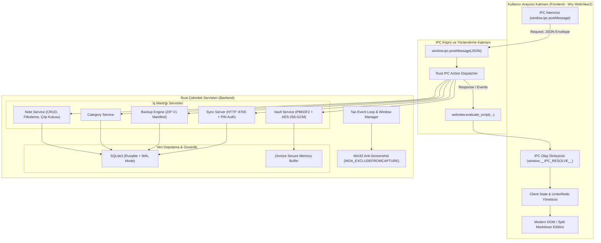
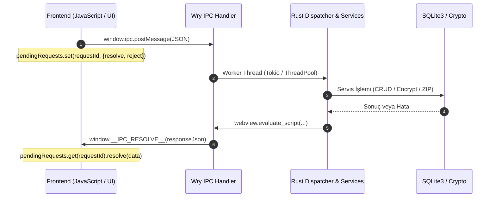
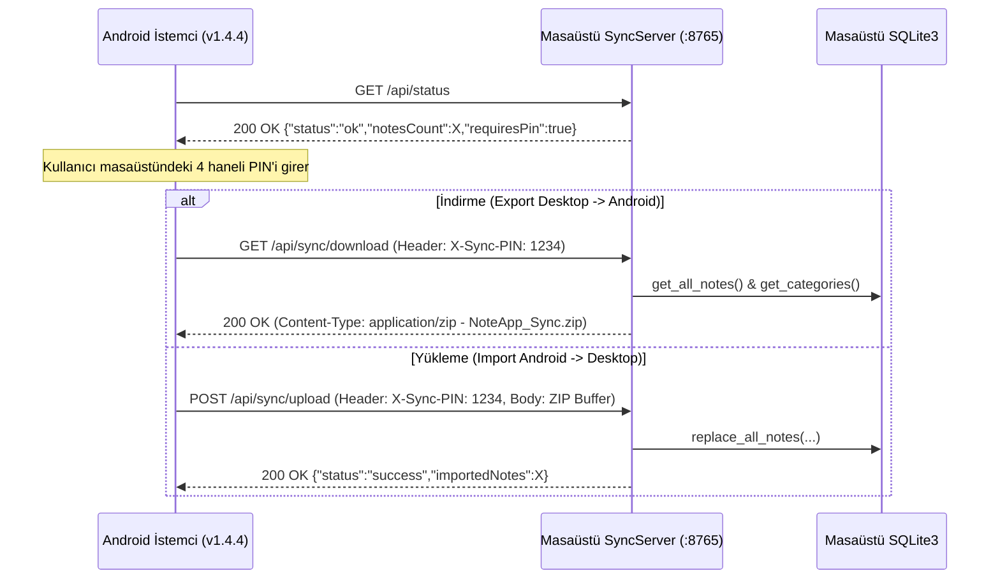

# Not Defterim Masaüstü (desktop-native) Mimari Teknik Şartnamesi
**Sürüm:** 1.0.0-PROD  
**Tarih:** 2026-11-04  
**Hedef Platform:** Windows 10/11 x64 (Native Wry + Tao + Rust)  
**Uyumluluk:** Android v1.4.4 Eşdeğer Veri ve Senkronizasyon Standardı  
**Rol:** Baş Sistem Mimarı (`system-architect`)

---

## 1. Giriş ve Mimari Vizyon

Not Defterim Masaüstü uygulaması; Electron veya benzeri ağır çalışma zamanlarının getirdiği yüksek RAM ve disk maliyetlerini ortadan kaldıran, işletim sisteminin yerel web görüntüleyicisini (Windows WebView2) kullanan, çekirdek iş mantığını ve veri tabanını saf Rust (`tao` + `wry` + `rusqlite`) ile yürüten ultra-hafif (< 30 MB RAM) ve yüksek güvenlikli bir masaüstü not alma platformudur.

### 1.1 Temel Mimari Prensipler
1. **Sıfır Bellek ve Kaynak İsrafı (Zero Bloat):** Saf native Rust çekirdeği ile anlık açılış süresi (< 200 ms) ve minimal bellek ayak izi.
2. **Çift Yönlü Güvenli IPC (Inter-Process Communication):** WebView kullanıcı arayüzü ile Rust çekirdeği arasında `window.ipc.postMessage` ve `evaluate_script` tabanlı asenkron, tip-güvenli mesajlaşma.
3. **Android v1.4.4 ile %100 Veri ve Senkronizasyon Uyumluluğu:** Mobil uygulama ile aynı veri modelleri (`Note`, `Category`, `SyncState`), AES-256-GCM kasa şifreleme formatı ve port 8765 LAN senkronizasyon protokolü.
4. **Windows Native Güvenlik (Zero-Leakage):** Win32 API (`SetWindowDisplayAffinity`) ile ekran görüntüsü, ekran kaydı ve uzaktan ekran paylaşımı sırasında kasanın ve hassas notların karartılması.
5. **Katmanlı Ayrıştırma:** Veri tabanı, kriptografi, yedekleme ve senkronizasyon modüllerinin birbirinden bağımsız çalışan saf Rust servisleri haline getirilmesi.

---

## 2. Sistem Katman Mimarisi



---

## 3. Rust Modül Sorumluluk Şartnamesi (`desktop-native/src/`)

| Dosya | Sorumluluk Alanı | Temel Bağımlılıklar & İşlevler |
| :--- | :--- | :--- |
| `main.rs` | Tao Event Loop, Wry WebView konfigürasyonu, Win32 Native API entegrasyonu, IPC Request Dispatcher | `tao`, `wry`, `windows-sys` / `windows` |
| `models.rs` | Android v1.4.4 ile %100 eşdeğer Note, Category, SyncState, Vault ve IPC DTO sözleşmeleri | `serde`, `serde_json` |
| `db.rs` | SQLite3 şeması, CRUD operasyonları, WAL modu, Composite İndeksler, Transaction yönetimi | `rusqlite` (bundled), `r2d2` |
| `crypto.rs` | Vault şifreleme, PBKDF2 (65.536 tur), AES-256-GCM, Zeroize bellek temizliği, Constant-Time karşılaştırma | `aes-gcm`, `sha2`, `rand`, `base64` |
| `backup.rs` | ZIP arşivi dışa/içe aktarım, `notes.json`, `categories.json`, `metadata.json` versiyon 1 doğrulama | `zip`, `std::fs` |
| `sync_server.rs` | Android ile LAN senkronizasyonu (Port 8765), PIN doğrulama, REST & ZIP HTTP sunucusu | `tiny_http`, `serde_json`, `std::sync` |

---

## 4. Frontend - Backend IPC Protokol Şartnamesi

Mevcut prototipte özel URL protokolü (`notdefterim://` ve HTTP POST `/api`) kullanılmıştır. Nihai mimaride bu yapı, Wry'ın saf yerel köprüsü olan `with_ipc_handler` ve `evaluate_script` mekanizmasıyla tam asenkron, çift yönlü ve olay güdümlü hale getirilmektedir.

### 4.1 İletişim Zarfı Formatı (Message Envelope)

#### A. Frontend -> Rust (Request)
Frontend, her istek için benzersiz bir `requestId` üretir ve `window.ipc.postMessage` fonksiyonuna serialize edilmiş JSON gönderir:

```json
{
  "action": "namespace:method",
  "payload": {
    "key": "value"
  },
  "requestId": "req_1714856400000_1"
}
```

*Standart Alanlar:*
- `action` (string, zorunlu): `namespace:method` yapısında (Örn: `db:getNotes`, `vault:unlock`, `sync:getState`).
- `payload` (object, opsiyonel): İlgili metodun parametreleri. Parametre yoksa `{}` veya `null`.
- `requestId` (string, zorunlu): İsteği yanıtla eşleştiren benzersiz istemci anahtarı.

#### B. Rust -> Frontend (Response)
Rust backend isteği tamamladığında WebView üzerinde `window.__IPC_RESOLVE__` fonksiyonunu `evaluate_script` ile tetikler:

```json
{
  "requestId": "req_1714856400000_1",
  "success": true,
  "data": { ... },
  "error": null
}
```

Hata Durumunda:
```json
{
  "requestId": "req_1714856400000_1",
  "success": false,
  "data": null,
  "error": {
    "code": "VAULT_INVALID_PASSWORD",
    "message": "Kasa şifresi hatalı veya doğrulanamadı."
  }
}
```

#### C. Rust -> Frontend (Asenkron Olay / Push Event)
Rust tarafından bağımsız olarak tetiklenen sistem bildirimleri (ör. Android senkronizasyonu tamamlandığında veya PIN yenilendiğinde) `window.__IPC_EMIT__` ile aktarılır:

```json
{
  "event": "sync:statusChanged",
  "data": {
    "isRunning": true,
    "port": 8765,
    "pin": "4821",
    "connectedClients": 1
  }
}
```

---

### 4.2 IPC Sıralama ve Akış Diyagramı



---

### 4.3 Kapsamlı IPC Action Kataloğu

#### Modül: `db:*` (Veritabanı & Not İşlemleri)
1. **`db:getNotes`**
   - **Açıklama:** Aktif, arşivlenmiş, çöp kutusundaki notları ve kategorileri tek seferde döndürür.
   - **Payload:** `{}`
   - **Dönen Veri:**
     ```json
     {
       "active": [Note],
       "archived": [Note],
       "trash": [Note],
       "categories": [Category],
       "isVaultUnlocked": false
     }
     ```
2. **`db:saveNote`**
   - **Açıklama:** Yeni not oluşturur veya mevcut notu günceller.
   - **Payload:** `{ "note": Note }`
   - **Dönen Veri:** `{ "id": 42, "updatedAt": 1714856400000 }`
3. **`db:moveToTrash`**
   - **Açıklama:** Notu çöp kutusuna taşır (`isInTrash = true`, `deletedAt = now`).
   - **Payload:** `{ "id": 42 }`
   - **Dönen Veri:** `{ "success": true }`
4. **`db:restoreFromTrash`**
   - **Açıklama:** Notu çöpten geri yükler (`isInTrash = false`, `deletedAt = null`).
   - **Payload:** `{ "id": 42 }`
   - **Dönen Veri:** `{ "success": true }`
5. **`db:deletePermanently`**
   - **Açıklama:** Notu veritabanından kalıcı olarak siler.
   - **Payload:** `{ "id": 42 }`
   - **Dönen Veri:** `{ "success": true }`
6. **`db:emptyTrash`**
   - **Açıklama:** Çöp kutusundaki tüm notları kalıcı olarak temizler.
   - **Payload:** `{}`
   - **Dönen Veri:** `{ "deletedCount": 5 }`
7. **`db:getCategories`**
   - **Açıklama:** Tüm kategorileri listeler.
   - **Payload:** `{}`
   - **Dönen Veri:** `[Category]`
8. **`db:saveCategory`**
   - **Açıklama:** Kategori ekler veya günceller.
   - **Payload:** `{ "id": 0, "name": "İş", "color": -1877005509 }`
   - **Dönen Veri:** `{ "id": 1 }`
9. **`db:deleteCategory`**
   - **Açıklama:** Kategoriyi siler (bağlı notların `categoryId` değeri NULL olur).
   - **Payload:** `{ "id": 1 }`
   - **Dönen Veri:** `{ "success": true }`

#### Modül: `vault:*` (Güvenli Kasa İşlemleri)
1. **`vault:getStatus`**
   - **Açıklama:** Kasa durumunu bildirir.
   - **Dönen Veri:** `{ "hasPassword": true, "isUnlocked": false }`
2. **`vault:setup`**
   - **Açıklama:** İlk defa ana parola belirler.
   - **Payload:** `{ "password": "master_secret_password" }`
   - **Dönen Veri:** `{ "success": true }`
3. **`vault:unlock`**
   - **Açıklama:** Kasayı belirtilen parola ile açar ve hafızada şifre çözme anahtarını türetir.
   - **Payload:** `{ "password": "master_secret_password" }`
   - **Dönen Veri:** `{ "success": true }`
4. **`vault:lock`**
   - **Açıklama:** Kasayı kilitler, hafızadaki anahtar byte'larını sıfırlar (`zeroize`).
   - **Payload:** `{}`
   - **Dönen Veri:** `{ "success": true }`

#### Modül: `sync:*` (LAN Senkronizasyonu)
1. **`sync:getState`**
   - **Açıklama:** Yerel senkronizasyon sunucusunun durumunu döner.
   - **Dönen Veri:** `SyncState`
2. **`sync:start`**
   - **Açıklama:** HTTP senkronizasyon sunucusunu `0.0.0.0:8765` üzerinde başlatır.
   - **Dönen Veri:** `SyncState`
3. **`sync:stop`**
   - **Açıklama:** Senkronizasyon sunucusunu durdurur.
   - **Dönen Veri:** `{ "isRunning": false }`
4. **`sync:refreshPin`**
   - **Açıklama:** Yeni 4 haneli rastgele eşleştirme PIN'i üretir.
   - **Dönen Veri:** `{ "pin": "9214" }`

#### Modül: `backup:*` (Yedekleme & Geri Yükleme)
1. **`backup:export`**
   - **Açıklama:** Veritabanını Android uyumlu ZIP arşivi olarak dışa aktarır.
   - **Payload:** `{ "targetPath": "C:\\Backups\\backup.zip" }` (Opsiyonel, boşsa varsayılan klasör).
   - **Dönen Veri:** `{ "filePath": "...", "notesCount": 12, "categoriesCount": 3 }`
2. **`backup:import`**
   - **Açıklama:** Seçilen ZIP dosyasını doğrular ve veritabanına aktarır.
   - **Payload:** `{ "sourcePath": "C:\\Backups\\backup.zip" }`
   - **Dönen Veri:** `{ "notesImported": 12, "categoriesImported": 3 }`

#### Modül: `window:*` (Sistem & Güvenlik Entegrasyonu)
1. **`window:setAntiScreenshot`**
   - **Açıklama:** Win32 `SetWindowDisplayAffinity` ile ekran görüntüsü engellemesini açar/kapatır.
   - **Payload:** `{ "enable": true }`
   - **Dönen Veri:** `{ "enabled": true }`
2. **`window:minimize` / `window:maximize` / `window:close`**
   - **Açıklama:** Özel pencere kontrolleri için yerel pencere fonksiyonları.

---

## 5. Android v1.4.4 Uyumlu Veri Modelleri ve Eşleme Şartnamesi

Mobil uygulama (Room DB v1.4.4) ile Masaüstü uygulaması (Rusqlite) arasındaki JSON ve veritabanı sözleşmesi çift yönlü tam uyumlu olacak biçimde tasarlanmıştır.

### 5.1 `Note` Modeli

```rust
use serde::{Deserialize, Serialize};

#[derive(Debug, Clone, Serialize, Deserialize)]
pub struct Note {
    /// Room Primary Key (0 ise yeni kayıt)
    pub id: i64,

    /// Not başlığı
    pub title: String,

    /// Not içeriği (Kasa kilitli ise 'ENC_GCM_V1:...' şifreli metin)
    pub content: String,

    /// Son güncelleme Unix epoch milisaniye
    pub timestamp: i64,

    /// Android ARGB Int renk kodu (Varsayılan: 0)
    pub color: i32,

    /// Bağlı kategori ID'si (Foreign Key)
    #[serde(rename = "categoryId")]
    pub category_id: Option<i64>,

    /// Başa tutturulmuş not bayrağı
    #[serde(rename = "isPinned")]
    pub is_pinned: bool,

    /// Şifreli kasa notu bayrağı
    #[serde(rename = "isLocked")]
    pub is_locked: bool,

    /// Arşivlenmiş not bayrağı
    #[serde(rename = "isArchived")]
    pub is_archived: bool,

    /// Çöp kutusu bayrağı (Android Room 'isDeleted' ile çift yönlü alias)
    #[serde(alias = "isDeleted", rename = "isInTrash")]
    pub is_in_trash: bool,

    /// Çöp kutusuna atılma zamanı (Unix ms)
    #[serde(rename = "deletedAt")]
    pub deleted_at: Option<i64>,

    /// Hatırlatıcı tarihi (Android 'reminderTime' ile çift yönlü alias)
    #[serde(alias = "reminderTime", rename = "reminderDateTime")]
    pub reminder_date_time: Option<i64>,

    /// Etiket listesi (Android v1.4.4 etiket desteği)
    #[serde(default)]
    pub tags: Vec<String>,

    /// Ek dosya ve görsel yolları
    #[serde(default)]
    pub attachments: Vec<String>,

    /// Oluşturulma tarihi Unix ms
    #[serde(rename = "createdAt", default = "default_timestamp")]
    pub created_at: i64,

    /// Güncellenme tarihi Unix ms
    #[serde(rename = "updatedAt", default = "default_timestamp")]
    pub updated_at: i64,

    /// Arka plan görsel yolu veya URI
    #[serde(rename = "backgroundImage")]
    pub background_image: Option<String>,

    /// Klasör ID'si (Opsiyonel)
    #[serde(rename = "folderId")]
    pub folder_id: Option<i64>,
}

fn default_timestamp() -> i64 {
    std::time::SystemTime::now()
        .duration_since(std::time::UNIX_EPOCH)
        .unwrap_or_default()
        .as_millis() as i64
}
```

### 5.2 `Category` Modeli

```rust
#[derive(Debug, Clone, Serialize, Deserialize)]
pub struct Category {
    pub id: i64,
    pub name: String,
    pub color: i32,
}
```

### 5.3 `SyncState` Modeli

```rust
#[derive(Debug, Clone, Serialize, Deserialize)]
pub struct SyncState {
    #[serde(rename = "isRunning")]
    pub is_running: bool,
    
    pub port: u16, // Sabit 8765
    
    pub pin: String, // 4 haneli rastgele eşleştirme PIN kodu
    
    #[serde(rename = "connectedClients")]
    pub connected_clients: usize,

    #[serde(rename = "localIp")]
    pub local_ip: String,

    #[serde(rename = "lastMessage")]
    pub last_message: String,
}
```

### 5.4 `VaultStatus` Modeli

```rust
#[derive(Debug, Clone, Serialize, Deserialize)]
pub struct VaultStatus {
    #[serde(rename = "hasPassword")]
    pub has_password: bool,

    #[serde(rename = "isUnlocked")]
    pub is_unlocked: bool,
}
```

---

## 6. Veritabanı ve Depolama Şartnamesi (SQLite3)

### 6.1 DDL Şeması
```sql
PRAGMA journal_mode = WAL;
PRAGMA busy_timeout = 5000;
PRAGMA foreign_keys = ON;

CREATE TABLE IF NOT EXISTS categories (
    id INTEGER PRIMARY KEY AUTOINCREMENT,
    name TEXT NOT NULL UNIQUE,
    color INTEGER NOT NULL DEFAULT 0
);

CREATE TABLE IF NOT EXISTS notes (
    id INTEGER PRIMARY KEY AUTOINCREMENT,
    title TEXT NOT NULL,
    content TEXT NOT NULL,
    timestamp INTEGER NOT NULL,
    color INTEGER NOT NULL DEFAULT 0,
    categoryId INTEGER,
    isPinned INTEGER NOT NULL DEFAULT 0,
    isArchived INTEGER NOT NULL DEFAULT 0,
    isInTrash INTEGER NOT NULL DEFAULT 0,
    deletedAt INTEGER,
    isLocked INTEGER NOT NULL DEFAULT 0,
    reminderDateTime INTEGER,
    tags TEXT NOT NULL DEFAULT '[]',
    attachments TEXT NOT NULL DEFAULT '[]',
    createdAt INTEGER NOT NULL,
    updatedAt INTEGER NOT NULL,
    backgroundImage TEXT,
    folderId INTEGER,
    FOREIGN KEY (categoryId) REFERENCES categories(id) ON DELETE SET NULL
);

-- Hızlı Liste ve Arama İndeksleri
CREATE INDEX IF NOT EXISTS idx_notes_status ON notes(isInTrash, isArchived, isPinned, updatedAt DESC);
CREATE INDEX IF NOT EXISTS idx_notes_category ON notes(categoryId);
CREATE INDEX IF NOT EXISTS idx_notes_reminder ON notes(reminderDateTime) WHERE reminderDateTime IS NOT NULL;
CREATE INDEX IF NOT EXISTS idx_notes_locked ON notes(isLocked);
CREATE INDEX IF NOT EXISTS idx_notes_trash ON notes(isInTrash, deletedAt);
```

### 6.2 Alan Eşleştirme Sözlüğü (Mapping Matrix)
| Rust Struct Alanı | Android Room Sütun Adı | JSON Serde Anahtarı | SQLite3 Sütun Tipi |
| :--- | :--- | :--- | :--- |
| `id` | `id` | `id` | `INTEGER PRIMARY KEY` |
| `title` | `title` | `title` | `TEXT NOT NULL` |
| `content` | `content` | `content` | `TEXT NOT NULL` |
| `timestamp` | `timestamp` | `timestamp` | `INTEGER NOT NULL` |
| `color` | `color` | `color` | `INTEGER NOT NULL` |
| `category_id` | `categoryId` | `categoryId` | `INTEGER` |
| `is_pinned` | `isPinned` | `isPinned` | `INTEGER (0/1)` |
| `is_archived` | `isArchived` | `isArchived` | `INTEGER (0/1)` |
| `is_in_trash` | `isDeleted` | `isInTrash` / `isDeleted` | `INTEGER (0/1)` |
| `deleted_at` | `deletedAt` | `deletedAt` | `INTEGER` |
| `is_locked` | `isLocked` | `isLocked` | `INTEGER (0/1)` |
| `reminder_date_time`| `reminderTime` | `reminderDateTime` / `reminderTime` | `INTEGER` |
| `tags` | `@TypeConverter tags`| `tags` | `TEXT (JSON Array)` |
| `attachments` | `@TypeConverter attachments` | `attachments` | `TEXT (JSON Array)` |
| `created_at` | `createdAt` | `createdAt` | `INTEGER` |
| `updated_at` | `updatedAt` | `updatedAt` | `INTEGER` |
| `background_image` | `backgroundImage` | `backgroundImage` | `TEXT` |
| `folder_id` | `folderId` | `folderId` | `INTEGER` |

---

## 7. Android LAN Senkronizasyon Protokolü (Port 8765)

Android istemcisi `DesktopSyncClient`, yerel ağdaki masaüstü sunucusuna bağlanırken aşağıdaki HTTP sözleşmesini kullanır:



### Güvenlik Kuralları:
1. **PIN Doğrulama:** `X-Sync-PIN` veya `X-Pairing-PIN` başlıkları kontrol edilir. Eşleşme sağlanamazsa derhal `401 Unauthorized` döner.
2. **IP Kısıtlaması:** Yalnızca yerel alt ağdan (RFC 1918: `192.168.x.x`, `10.x.x.x`, `172.16.x.x`) gelen isteklere izin verilir.
3. **ZIP Arşivi Doğrulama:** Gönderilen ZIP dosyasının içinde `metadata.json` versiyonu kontrol edilir; dosya dizin geçişi (Path Traversal / Zip Slip) saldırılarına karşı sanitize edilir.

---

## 8. Güvenlik ve Windows Native Optimizasyonları

1. **Anti-Screenshot Koruması:**
   ```rust
   #[cfg(windows)]
   pub fn apply_anti_screenshot(hwnd: isize, enable: bool) {
       use windows::Win32::Foundation::HWND;
       use windows::Win32::UI::WindowsAndMessaging::{
           SetWindowDisplayAffinity, WDA_EXCLUDEFROMCAPTURE, WDA_NONE,
       };
       let affinity = if enable { WDA_EXCLUDEFROMCAPTURE } else { WDA_NONE };
       unsafe {
           SetWindowDisplayAffinity(HWND(hwnd as _), affinity).ok();
       }
   }
   ```
2. **Kasa Bellek Koruması (Zeroize):**
   Şifreleme anahtarları ve parola baytları kullanım sonrasında hafızada bırakılmaz; `zeroize` fonksiyonu ve `compiler_fence` ile bellekten silinir.
3. **Zamanlama Saldırısı Koruması (Constant-Time Compare):**
   Kasa parola hash'leri ve senkronizasyon PIN kontrolleri XOR tabanlı sabit-zamanlı döngüyle kıyaslanır.

---

## 9. Uzman Alt Agent'lar İçin Görev ve Uygulama Şartnamesi

Bu şartname uyarınca aşağıdaki uzman alt agent'lar doğrudan uygulama adımlarını üstlenir:

1. **`database-schema-designer`:**
   - `desktop-native/src/db.rs` dosyasını Android v1.4.4 şemasına tam uyumlu hale getirmek (`isInTrash`, `reminderDateTime`, `tags` JSON dizisi, yeni indeksler).
   - `models.rs` içindeki serde özniteliklerini alias ve rename kurallarıyla senkronize etmek.
2. **`business-logic-engineer`:**
   - `desktop-native/src/main.rs` içerisindeki `handle_api_request` fonksiyonunu `namespace:method` zarf formatına dönüştürmek.
   - Wry `with_ipc_handler` fonksiyonunu devreye almak.
3. **`client-state-architect`:**
   - `desktop-native/ui/app.js` dosyasındaki `callIpc` mekanizmasını `window.ipc.postMessage` ve `requestId` Promise havuzuna taşımak.
   - Event dinleyicisi `window.__IPC_EMIT__` yapısını UI durumuna entegre etmek.
4. **`unit-test-engineer`:**
   - `models.rs` JSON serileştirme testleri, `crypto.rs` şifreleme/çözme testleri ve `backup.rs` ZIP oluşturma/açma birim testlerini yazıp doğrulamak.
