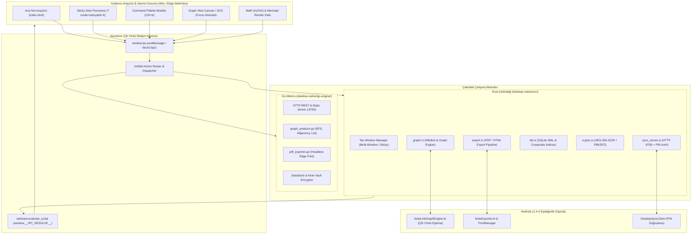
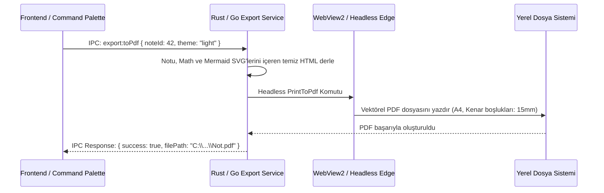

# Not Defterim Masaüstü Sistem Mimarisi V2 (Büyük Geliştirme Sprinti)
**Sürüm:** 2.0.0-SPRINT  
**Tarih:** 2026-11-05  
**Hedef Ortamlar:** Rust Backend (`desktop-native/src/`), Go Motoru (`desktop-native/go-engine/`), Modern Web UI (`desktop-native/ui/`), Android v1.4.4 Entegrasyonu  
**Rol:** Baş Sistem Mimarı (`system-architect`)

---

## 1. Yönetici Özeti ve 5 Saatlik Sprint Hedefleri

Not Defterim ekosistemi, yerel birinci sınıf (local-first), şifrelenmiş ve ultra hafif bir kişisel bilgi yönetim sistemidir (PKM). Bu mimari şartname (V2), mevcut kararlı Rusqlite/Go altyapısı üzerine inşa edilecek **5 büyük kurumsal yeteneğin** uçtan uca mimari şartnamesini, veri modellerini, IPC sözleşmelerini ve platformlar arası entegrasyon kurallarını belirler:

1. **Graph View (Bağlantı Grafiği Analizcisi):** Notlar arası `[[Wikilink]]` bağlantılarını, geri referansları (backlinks), merkez düğümleri (hub) ve hayalet (phantom) notları görselleştiren dinamik kuvvet-yönlendirmeli (force-directed) graf analiz motoru.
2. **Command Palette (Evrensel Komut Paleti):** `Ctrl+K` / `Ctrl+P` kısayollarıyla tetiklenen, bulanık aramalı (fuzzy search), klavye odaklı IPC ve durum yönetim sistemi.
3. **Sticky Note Modu (Masaüstü Yapışkan Not):** Belirli notların masaüstünde bağımsız, her zaman üstte (always-on-top), minimal ve odaklanmış pencere olarak açılmasını sağlayan çoklu pencere mimarisi (`?mode=sticky&id=...`).
4. **Math (KaTeX) & Mermaid Render Motoru:** LaTeX matematik formüllerini ve Mermaid diyagramlarını yerel, çevrimdışı ve güvenli bir şekilde derleyip render eden zengin Markdown motoru.
5. **PDF & Vektörel Dışa Aktarma Motoru:** Matematiksel formüller, diyagramlar ve biçimlendirilmiş metinleri yüksek kaliteli A4 PDF/HTML/Markdown çıktılarına dönüştüren yazdırma hattı.

---

## 2. Sistem Mimarisi V2 Katman Şeması



---

## 3. Özellik 1: Graph View (Bağlantı Grafiği Analizcisi & Wikilink Grafiği)

### 3.1 Amaç ve Mimari Tasarım
Kullanıcıların notlar arasındaki `[[Hedef Not]]` veya `[[Hedef Not|Görünen Metin]]` sözdizimini otomatik olarak çözümleyen; notları düğüm (node), referansları kenar (edge) olarak modelleyen iki yönlü graf analiz motorudur. Android'deki `NoteLinkGraphEngine.kt` ile tam eşdeğer çalışır.

### 3.2 Matematiksel ve Algoritmik Yapı
- **Regex Ayrıştırıcı:** `\[\[([^\]\|]+)(?:\|([^\]]+))?\]\]`
- **Düğüm Türleri:**
  - `ExistingNode`: Veritabanında karşılığı olan not.
  - `PhantomNode`: Metinlerde `[[...]]` ile atıfta bulunulmuş ancak henüz oluşturulmamış hayalet not.
- **Metrikler:**
  - `In-Degree` (Backlink sayısı): Notu kaç farklı not referans gösteriyor.
  - `Out-Degree` (Forward links): Not içinden kaç farklı nota atıf yapılmış.
  - `Hub Notes`: En yüksek `in-degree + out-degree` toplamına sahip ilk %10 düğüm (graf merkezleri).
  - `Orphan Notes`: Hiçbir giden veya gelen bağlantısı olmayan izole notlar.
  - `Shortest Path (BFS)`: İki not arasındaki en kısa kavramsal bağlantı yolu.

### 3.3 Veri Yapısı (JSON ve Rust/Go Modelleri)
```rust
#[derive(Debug, Clone, Serialize, Deserialize)]
pub struct GraphNode {
    pub id: String,                 // "note_42" veya "phantom_Kuantum"
    pub label: String,              // Not başlığı
    pub note_id: Option<i64>,       // Gerçek not ise ID, phantom ise None
    pub is_phantom: bool,           // Henüz oluşturulmamış not mu?
    pub in_degree: usize,           // Gelen bağlantı sayısı
    pub out_degree: usize,          // Giden bağlantı sayısı
    pub category_id: Option<i64>,   // Renklendirme ve kümeleme için
    pub color: String,              // Kategori veya grup rengi
    pub val: f32,                   // Düğüm yarıçapı (in_degree ile orantılı)
}

#[derive(Debug, Clone, Serialize, Deserialize)]
pub struct GraphEdge {
    pub source: String,             // Kaynak düğüm id
    pub target: String,             // Hedef düğüm id
    pub context_snippet: Option<String>, // Bağlantının geçtiği cümle özeti
}

#[derive(Debug, Clone, Serialize, Deserialize)]
pub struct GraphDataResponse {
    pub nodes: Vec<GraphNode>,
    pub edges: Vec<GraphEdge>,
    pub stats: GraphStats,
}

#[derive(Debug, Clone, Serialize, Deserialize)]
pub struct GraphStats {
    pub total_nodes: usize,
    pub total_edges: usize,
    pub orphan_count: usize,
    pub hub_nodes: Vec<(String, usize)>, // (Başlık, bağlantı sayısı)
}
```

### 3.4 IPC Sözleşmesi
- **Action:** `graph:getGraph`
  - **Payload:** `{ "includeArchived": false, "categoryId": null }`
  - **Response:** `GraphDataResponse`
- **Action:** `graph:getNodeDetails`
  - **Payload:** `{ "noteId": 42 }`
  - **Response:** `{ "inbound": [WikilinkSnippet], "outbound": [WikilinkSnippet], "phantomTitles": [String], "secondDegree": [GraphNode] }`

---

## 4. Özellik 2: Command Palette (Evrensel Komut Paleti)

### 4.1 Amaç ve Kullanıcı Deneyimi (UX)
Klavye odaklı kullanıcıların ellerini klavyeden kaldırmadan tüm uygulama fonksiyonlarına, ayarlara, notlara ve IPC servislerine anında erişmesini sağlar. `Ctrl+K` veya `Ctrl+P` ile açılır.

### 4.2 Komut Kayıt Defteri (Command Registry)
Komutlar statik (eylemler) ve dinamik (notlar ve kategoriler) olarak ikiye ayrılır.

```typescript
interface CommandItem {
  id: string;              // "note:new", "view:toggleTheme", "nav:note_42"
  title: string;           // "Yeni Not Oluştur", "Karanlık/Aydınlık Tema Değiştir"
  category: 'Notlar' | 'Görünüm' | 'Kasa' | 'Senkronizasyon' | 'Dışa Aktar' | 'Sistem';
  keywords: string[];      // Fuzzy matching için eş anlamlı kelimeler
  shortcut?: string;       // "Ctrl+N", "Ctrl+D"
  icon: string;            // Feather/SVG ikon kimliği
  action: () => void | Promise<void>;
}
```

### 4.3 Fuzzy Search Algoritması
Levenshtein mesafesi ve ardışık harf eşleşme skoru (Sublime Text / VS Code tarzı) bir arada çalışır:
1. Başlıkta ardışık karakter eşleşmesi: `+100` puan.
2. Kelime başlangıcındaki harf eşleşmesi (Akronim): `+80` puan.
3. Kategori içi eşleşme: `+40` puan.
4. Karakter aralığı cezası: `-1` puan / atlanan karakter.

### 4.4 IPC Eylem Haritalaması
Komut paleti üzerinden seçilen bir eylem, doğrudan `Unified IPC Dispatcher` üzerinden çağrılır:
- `"Senkronizasyonu Başlat"` -> `sync:start`
- `"Kasayı Kilitle"` -> `vault:lock`
- `"Hızlı Yedek Al (ZIP)"` -> `backup:export`
- `"PDF Olarak Dışa Aktar"` -> `export:toPdf`
- `"Yapışkan Not Olarak Aç"` -> `window:openStickyNote`

---

## 5. Özellik 3: Sticky Note Modu (Masaüstü Yapışkan Not)

### 5.1 Amaç ve Pencere Mimarisi
Kullanıcının odaklandığı belirli bir notu masaüstünde diğer pencerelerin üzerinde (`Always-on-Top`), kenarlıksız (`Frameless`) ve yarı-saydam ayarlanabilir bir pencerede bağımsız post-it gibi tutabilmesini sağlar.

### 5.2 Çoklu Pencere & URL Modu Mimarisi
- Pencere URL'si: `index.html?mode=sticky&id=42`
- **Rust (Tao + Wry) Tarafı:**
  ```rust
  pub fn open_sticky_window(event_loop: &EventLoopWindowTarget<()>, note_id: i64) {
      let window = WindowBuilder::new()
          .with_title(format!("Not #{} - Yapışkan Not", note_id))
          .with_inner_size(LogicalSize::new(340.0, 420.0))
          .with_min_inner_size(LogicalSize::new(240.0, 200.0))
          .with_always_on_top(true)
          .with_decorations(false) // Özel minimal başlık çubuğu için
          .with_resizable(true)
          .build(event_loop)
          .unwrap();

      let url = format!("notdefterim://localhost/index.html?mode=sticky&id={}", note_id);
      let _webview = WebViewBuilder::new(&window)
          .with_url(&url)
          .build()
          .unwrap();
  }
  ```
- **Go Motoru Tarafı:**
  Edge App modunda bağımsız pencere olarak başlatılır:
  `msedge.exe --app="http://127.0.0.1:8765/?mode=sticky&id=42" --window-size=340,420`

### 5.3 UI Adaptasyonu (`app.js` & `style.css`)
- `URLSearchParams` kontrolü: `mode === 'sticky'` ise:
  - Sol kenar çubuğu (Sidebar), arama çubuğu ve ana navigasyon tamamen gizlenir.
  - Pencereye özel minimal sürükleme alanı (`data-tauri-drag-region` veya Win32 WM_NCHITTEST) ve pin/kapat butonları eklenir.
  - Not içeriği tam ekran düzenleme moduna geçer, arkaplan rengi notun rengine bürünür.
  - Otomatik kaydetme süresi 1 saniyeye çekilir; ana pencere ile veritabanı üzerinden anında senkronize olur.

---

## 6. Özellik 4: Math (KaTeX) & Mermaid Render Motoru

### 6.1 Güvenli ve Çevrimdışı Çalışma Prensibi
İnternet bağlantısı gerektirmeyen, CDN bağımlılığı olmayan, yerel paketlenmiş (bundled) KaTeX ve Mermaid.js kütüphaneleri kullanılacaktır.
- **XSS & Güvenlik Politikası (CSP):**
  - Script injection saldırılarını önlemek için HTML Sanitizer (DOMPurify standardı) zorunludur.
  - KaTeX: Yalnızca matematiksel semboller ve formüller render edilir; `\href`, `\url` gibi tehlikeli makrolar kısıtlanır (`trust: false`).
  - Mermaid: Güvenlik seviyesi `securityLevel: 'strict'` olarak ayarlanır.

### 6.2 Sözdizimi ve Ayrıştırma Kuralları
1. **Satır İçi Matematik (Inline Math):**
   `$E = mc^2$` veya `$` ile çevrelenmiş ifadeler -> `katex.renderToString(expr, { displayMode: false })`
2. **Blok Matematik (Block Math):**
   ```text
   $$
   f(x) = \int_{-\infty}^\infty \hat f(\xi)\,e^{2 \pi i \xi x}\,d\xi
   $$
   ```
   -> `katex.renderToString(expr, { displayMode: true })`
3. **Mermaid Diyagramları:**
   ````text
   ```mermaid
   graph TD;
       A[Kavram] --> B[Sonuç];
   ```
   ````
   -> DOM üzerinde benzersiz SVG kimliğiyle `mermaid.render('svg_id', code)` çalıştırılır.

### 6.3 Canlı Önizleme Performansı (Debounced Incremental Rendering)
- Editörde her tuş vuruşunda tüm belgeyi baştan derlemek yerine:
  - 300 ms debounce uygulanır.
  - Yalnızca içeriği değişen matematik veya diyagram blokları DOM üzerinde güncellenir (DOM diffing).

---

## 7. Özellik 5: PDF ve Vektörel Dışa Aktarma Motoru

### 7.1 Dışa Aktarma Formatları ve Hedefleri
| Format | Kullanım Amacı | Motor / Araç |
| :--- | :--- | :--- |
| **PDF (Vektörel)** | Resmi dokümantasyon, baskı ve arşiv | WebView2 PrintToPdf / Headless Edge Print |
| **Biçimlendirilmiş HTML** | Web ortamında paylaşım | KaTeX CSS ve Mermaid SVG içeren tek dosya HTML |
| **Standart Markdown** | Taşınabilirlik ve Zettelkasten uyumu | Temiz `.md` dosyası + metadata frontmatter |

### 7.2 PDF Derleme Hattı (Export Pipeline)


### 7.3 Baskı Şablonu (`print.css`) Standartları
- `@media print` kuralları:
  - Kenar çubuğu, düğmeler, araç çubukları gizlenir (`display: none !important`).
  - Sayfa boyutu: `@page { size: A4; margin: 20mm; }`
  - Sayfa sonu kontrolleri: Başlıklar altında yetim satır kalmaması için `break-after: avoid;` uygulanır.
  - Vektörel Netlik: Mermaid diyagramları SVG formatında doğrudan yazdırılır, çözünürlük kaybı sıfırdır.
  - Üstbilgi ve Altbilgi: Not başlığı ve sayfa numaraları şablon CSS ile standartlaştırılır.

---

## 8. IPC Protokolü V2 Sözleşme Şartnamesi

Yeni yeteneklerle birlikte genişletilen IPC Action listesi aşağıdadır:

### 8.1 Yeni Action Kataloğu
| Action | Yön | Payload | Yanıt / Açıklama |
| :--- | :--- | :--- | :--- |
| `graph:getGraph` | UI -> Rust/Go | `{ categoryId?: i64 }` | `{ nodes: [], edges: [], stats: {} }` |
| `graph:getNodeDetails`| UI -> Rust/Go | `{ noteId: i64 }` | Backlinkler, giden linkler ve hayalet notlar |
| `window:openSticky` | UI -> Rust/Go | `{ noteId: i64 }` | Bağımsız Sticky penceresi başlatır |
| `window:setAlwaysOnTop`| UI -> Rust | `{ enable: bool }` | Aktif pencereyi en üste sabitler |
| `export:toPdf` | UI -> Rust/Go | `{ noteId: i64, path?: string }` | `{ success: true, filePath: string }` |
| `export:toHtml` | UI -> Rust/Go | `{ noteId: i64, path?: string }` | `{ success: true, filePath: string }` |
| `system:executeCmd` | UI -> Rust/Go | `{ commandId: string, args?: any }`| Komut paleti eylemini merkezi olarak çalıştırır |

---

## 9. 5 Saatlik Geliştirme Sprinti İş Bölümü & Alt Agent Görev Matrisi

Bu sprint planı, sistemin çökmesini veya mantıksal çakışmaları önlemek amacıyla katı aşamalı olarak tasarlanmıştır:

```mermaid
gantt
    title 5 Saatlik Büyük Geliştirme Sprinti Zaman Çizelgesi
    dateFormat  HH:mm
    axisFormat  %H:%M
    
    section Aşama 1: Çekirdek & Graf (00:00 - 01:15)
    Rust graph.rs & Go graph_engine.go Geliştirme      :a1, 00:00, 45m
    Android NoteLinkGraphEngine Senkronizasyonu         :a2, 00:30, 45m
    
    section Aşama 2: UI & Palette (01:15 - 02:30)
    Command Palette (Fuzzy Search & Modal)              :b1, 01:15, 45m
    Graph View Canvas/D3 Entegrasyonu                   :b2, 01:45, 45m
    
    section Aşama 3: Sticky & Render (02:30 - 03:45)
    Sticky Note Çoklu Pencere & URL Modu                :c1, 02:30, 40m
    KaTeX Math & Mermaid.js Render Motoru               :c2, 03:00, 45m
    
    section Aşama 4: PDF & Export (03:45 - 04:30)
    Vektörel PDF Baskı Hattı & print.css                :d1, 03:45, 45m
    
    section Aşama 5: Test & Montaj (04:30 - 05:00)
    Entegrasyon Testleri, Linter & GitHub Auto-Backup   :e1, 04:30, 30m
```



### Alt Agent Görev Dağılımı:
1. **`business-logic-engineer`:**
   - `desktop-native/src/graph.rs` ve `go-engine/graph_analyzer.go` modüllerini implemente eder.
   - Wikilink regex ayrıştırma, ters indeksleme (backlink mapping) ve hayalet not yönetimini kodlar.
2. **`client-state-architect` & `ui-ux-designer`:**
   - `command-palette.js` ve `command-palette.css` bileşenlerini oluşturur; `Ctrl+K` klavye dinleyicisini bağlar.
   - `graph-view.js` ile interaktif kuvvet-yönlendirmeli grafı çizer.
3. **`system-architect` & `launcher-script-dev`:**
   - Multi-window Tao mimarisini ve Sticky Note pencere yöneticisini yapılandırır (`?mode=sticky&id=...`).
4. **`design-system-engineer`:**
   - KaTeX ve Mermaid yerel kütüphanelerini bağlar; `print.css` baskı şablonlarını tasarlar.
5. **`unit-test-engineer` & `code-quality-auditor`:**
   - Graf analiz algoritmalarının, fuzzy match fonksiyonlarının ve dışa aktarma modüllerinin birim testlerini yazar ve doğrular.
6. **`assembly-integrator` & `auto-github-backup`:**
   - Tüm bileşenleri derler, nihai doğrulamayı yapar ve temiz commit ile GitHub'a yedekler.
